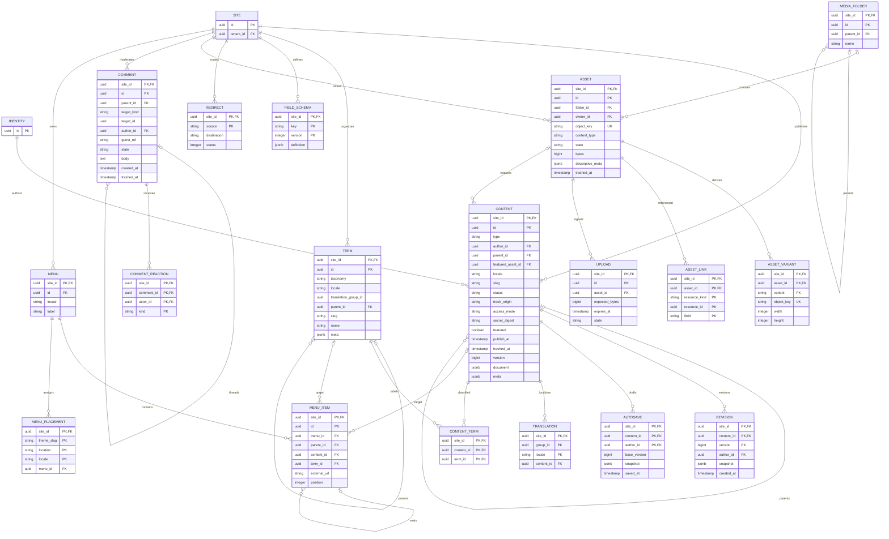
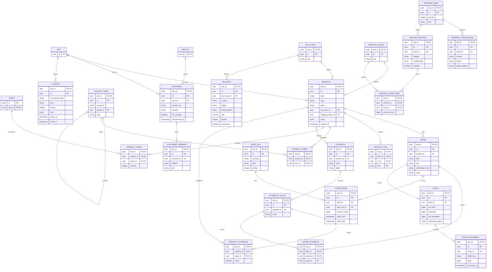
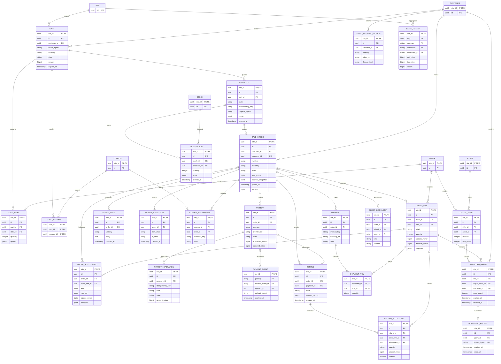
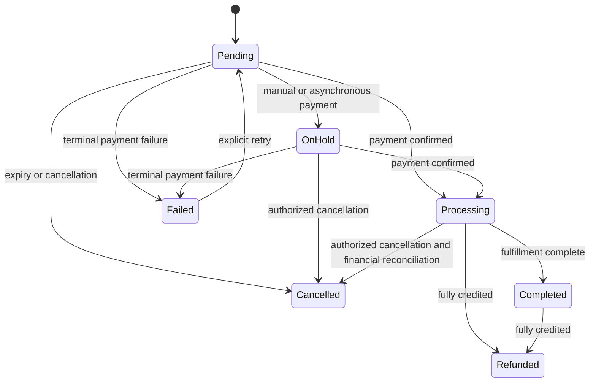

# Atlas logical data model

These ER diagrams describe the target, organized by ownership. Repeated anchors identify the same logical entity. Names are logical resource names. Plugin tables receive their owner prefix in physical migrations. PostgreSQL is authoritative for durable state. The database package owns shared infrastructure and each plugin owns its data through the public migration interface.

## Core and network

```mermaid
erDiagram
  TENANT {
    uuid id PK
    string slug UK
    string state
    timestamp created_at
  }
  SITE {
    uuid id PK
    uuid tenant_id FK
    string slug
    string locale
    string time_zone
    string state
  }
  SITE_DOMAIN {
    string hostname PK
    uuid site_id FK
    boolean canonical
  }
  IDENTITY {
    uuid id PK
    string email UK
    string password_hash
    timestamp verified_at
    string state
  }
  SITE_MEMBER {
    uuid site_id PK,FK
    uuid user_id PK,FK
    string state
  }
  NETWORK_GRANT {
    uuid tenant_id PK,FK
    uuid user_id PK,FK
    uuid role_id PK,FK
  }
  ROLE {
    uuid id PK
    uuid tenant_id FK
    uuid site_id FK
    string key
    string scope
  }
  CAPABILITY {
    string key PK
    string resource
  }
  ROLE_CAPABILITY {
    uuid role_id PK,FK
    string capability_key PK,FK
  }
  MEMBER_ROLE {
    uuid site_id PK,FK
    uuid user_id PK,FK
    uuid role_id PK,FK
  }
  USER_PROFILE {
    uuid site_id PK,FK
    uuid user_id PK,FK
    string locale
    jsonb meta
  }
  SESSION {
    uuid id PK
    uuid user_id FK
    uuid tenant_id FK
    uuid site_id FK
    timestamp expires_at
    timestamp revoked_at
  }
  REFRESH_CREDENTIAL {
    uuid id PK
    uuid session_id FK
    uuid previous_id FK
    string digest UK
    timestamp consumed_at
    timestamp expires_at
  }
  API_KEY {
    uuid id PK
    uuid site_id FK
    uuid user_id FK
    string digest UK
    jsonb scopes
    timestamp revoked_at
  }
  AUTH_FACTOR {
    uuid id PK
    uuid user_id FK
    string kind
    bytes encrypted_value
  }
  ACCOUNT_CHALLENGE {
    uuid id PK
    uuid user_id FK
    string kind
    string digest UK
    timestamp expires_at
    timestamp consumed_at
  }
  SITE_SETTING {
    uuid site_id PK,FK
    string key PK
    jsonb value
    integer schema_version
    bigint version
  }
  TENANT_SETTING {
    uuid tenant_id PK,FK
    string key PK
    jsonb value
    bigint version
  }
  AUDIT_ENTRY {
    uuid id PK
    uuid site_id FK
    uuid tenant_id FK
    uuid actor_id FK
    string action
    jsonb redacted_details
    timestamp recorded_at
  }
  PLUGIN_RELEASE {
    string slug PK
    string version PK
    string digest
    jsonb manifest
  }
  PLUGIN_ACTIVATION {
    uuid site_id PK,FK
    string slug PK,FK
    string version FK
    string state
    jsonb settings
  }
  MIGRATION_ENTRY {
    string namespace PK
    string version PK
    string checksum
    timestamp applied_at
  }
  JOB_SCHEDULE {
    uuid id PK
    uuid site_id FK
    string name
    string expression
    string time_zone
    timestamp next_at
    jsonb payload
  }
  JOB_EFFECT {
    uuid site_id PK,FK
    string dedupe_key PK
    string state
    timestamp updated_at
  }
  OUTBOX_EVENT {
    uuid id PK
    uuid site_id FK
    string name
    integer schema_version
    jsonb payload
    timestamp occurred_at
    timestamp dispatched_at
  }
  WEBHOOK {
    uuid id PK
    uuid site_id FK
    string endpoint
    string secret_ref
    jsonb subscriptions
    string state
  }
  WEBHOOK_ATTEMPT {
    uuid id PK
    uuid webhook_id FK
    uuid event_id FK
    integer attempt
    string result
    timestamp next_at
  }
  THEME_RELEASE {
    string slug PK
    string version PK
    jsonb manifest
    string digest
  }
  THEME_SELECTION {
    uuid site_id PK,FK
    string slug FK
    string version FK
    bigint revision
  }
  THEME_REVISION {
    uuid site_id PK,FK
    bigint revision PK
    jsonb settings
    jsonb template_overrides
    string state
  }
  TENANT ||--o{ SITE : contains
  SITE ||--o{ SITE_DOMAIN : routes
  SITE ||--o{ SITE_MEMBER : enrolls
  IDENTITY ||--o{ SITE_MEMBER : joins
  TENANT ||--o{ NETWORK_GRANT : scopes
  IDENTITY ||--o{ NETWORK_GRANT : holds
  ROLE ||--o{ NETWORK_GRANT : assigns
  TENANT ||--o{ ROLE : owns
  SITE ||--o{ ROLE : scopes
  ROLE ||--o{ ROLE_CAPABILITY : grants
  CAPABILITY ||--o{ ROLE_CAPABILITY : defines
  SITE_MEMBER ||--o{ MEMBER_ROLE : receives
  ROLE ||--o{ MEMBER_ROLE : assigns
  SITE_MEMBER ||--o| USER_PROFILE : has
  IDENTITY ||--o{ SESSION : starts
  SITE o|--o{ SESSION : scopes
  SESSION ||--o{ REFRESH_CREDENTIAL : rotates
  IDENTITY ||--o{ AUTH_FACTOR : owns
  IDENTITY ||--o{ ACCOUNT_CHALLENGE : receives
  SITE ||--o{ API_KEY : scopes
  IDENTITY ||--o{ API_KEY : owns
  SITE ||--o{ SITE_SETTING : configures
  TENANT ||--o{ TENANT_SETTING : configures
  TENANT ||--o{ AUDIT_ENTRY : records
  SITE ||--o{ AUDIT_ENTRY : records
  PLUGIN_RELEASE ||--o{ PLUGIN_ACTIVATION : selects
  SITE ||--o{ PLUGIN_ACTIVATION : enables
  SITE ||--o{ JOB_SCHEDULE : schedules
  SITE ||--o{ JOB_EFFECT : deduplicates
  SITE ||--o{ OUTBOX_EVENT : emits
  SITE ||--o{ WEBHOOK : registers
  WEBHOOK ||--o{ WEBHOOK_ATTEMPT : sends
  OUTBOX_EVENT ||--o{ WEBHOOK_ATTEMPT : triggers
  THEME_RELEASE ||--o| THEME_SELECTION : selects
  SITE ||--o| THEME_SELECTION : applies
  THEME_SELECTION ||--o{ THEME_REVISION : revises
```

## Publishing, media and navigation

## Commerce catalog, customers and rules

## Commerce transaction and delivery

## Keys and integrity

Use UUID identities unless the aggregate has a natural composite key. Site-owned references include `site_id` on both sides. Tenant-level references also constrain the parent tenant when a site or identity assignment is involved. Site-scoped settings, inventories, payloads and events carry explicit scope even when joined by globally unique IDs. Match role scope to its assignment and require exactly one canonical active domain per live site. The migration ledger keys a core or plugin namespace and migration version, with a recorded checksum.

Use deferred or transactional constraints for invariants involving multiple rows, such as a single active theme, per-order currency, order total reconciliation, exactly one menu item target, and valid product/attribute combinations. Shared media-use and comment targets are polymorphic: the registering domain validates the reference and publishes a lifecycle event for cleanup. These relations are intentionally absent as physical foreign keys. Cross-owner references use identifiers and compensating jobs where plugin uninstall would otherwise create a hard dependency. Database permissions scope plugin writers to their own tables.

## JSONB strategies

Use typed JSONB for sparse extension metadata, block trees, catalog rules, settings, address snapshots, immutable event payloads and document revisions. Validate versioned schemas at command boundaries and select only explicitly exposed fields for REST. Qualify custom keys by owner, allow controlled evolution and migrate before retiring old readers. Store secret references or encrypted values separately. Put relational constraints, money, visibility, ownership, expiry and hot sorting/filtering fields in columns. Store monetary amounts as integer minor units with a separate ISO currency, and use precise decimal rates with explicit rounding rules. Snapshot the evaluated line, address, rate and discount at checkout so historical documents survive catalog and rule changes.

## Indexing

- Lead tenant/site list indexes with scope. Use deterministic sort and ID tie-breaks for cursor paging. Index child-side foreign keys used for joins and deferred cleanup.
- Add partial uniqueness for active slugs per site/type/locale/parent, active SKU per site, canonical domain per site, code per store, and published price intervals where overlap is forbidden. Normalize case at write time with format rules that match the corresponding public URL or identifier.
- Index publication jobs by due time and claim state, outbox by undispatched time, stock reservations by expiry, and webhook attempts by retry time. Use operational indexes for order number, customer history, status/date, reconciliation provider ID and checkout idempotency key. Enforce uniqueness of stock effect, payment operation and provider event keys.
- Maintain weighted search documents with a GIN index and language configuration. Add targeted JSON expression indexes from observed query plans. Keep broad JSONB indexes off high-write tables unless a supported query needs one.
- Stream large histories and snapshots. Evaluate partitioning audit and delivery logs only after workload measurements.

## Trash, retention and revisions

User-facing deletions for content, media and catalog first capture a timestamp and prior state. Remove trashed resources from public reads immediately. Restore rechecks uniqueness, permissions and dependencies. Purge only after retention and dependency checks, and emit cleanup effects transactionally. Comments use moderation states and a separate trash policy. Order and tax evidence are retained under configurable policy, and erasure anonymizes personal data where retention requires preserving financial facts. Audit entries are append-only. Subject data in exports and logs follows separate retention policies.

Every content edit compares an expected version, persists the next version and records an immutable revision. Autosaves are private per author and record their base version. Conflicting writes return a current version for retry or explicit merge. Restoring a revision creates a new head and preserves history. Retention may prune old revisions after a policy window while keeping the current head and publish markers. Theme settings use separate revisions, with draft previews scoped by signed authorization.

## Order state machine

Checkout revalidates the cart and reserves stock, then links an order at most once per idempotency key. Payment and shipping each have their own state, and verified provider transitions are deduplicated and reconciled. A partial refund records allocations without marking the entire order refunded. Refunding requires a durable operation, amount/currency checks, and an explicit stock-restoration effect. No terminal commerce state is inferred solely from client navigation or a timeout.
