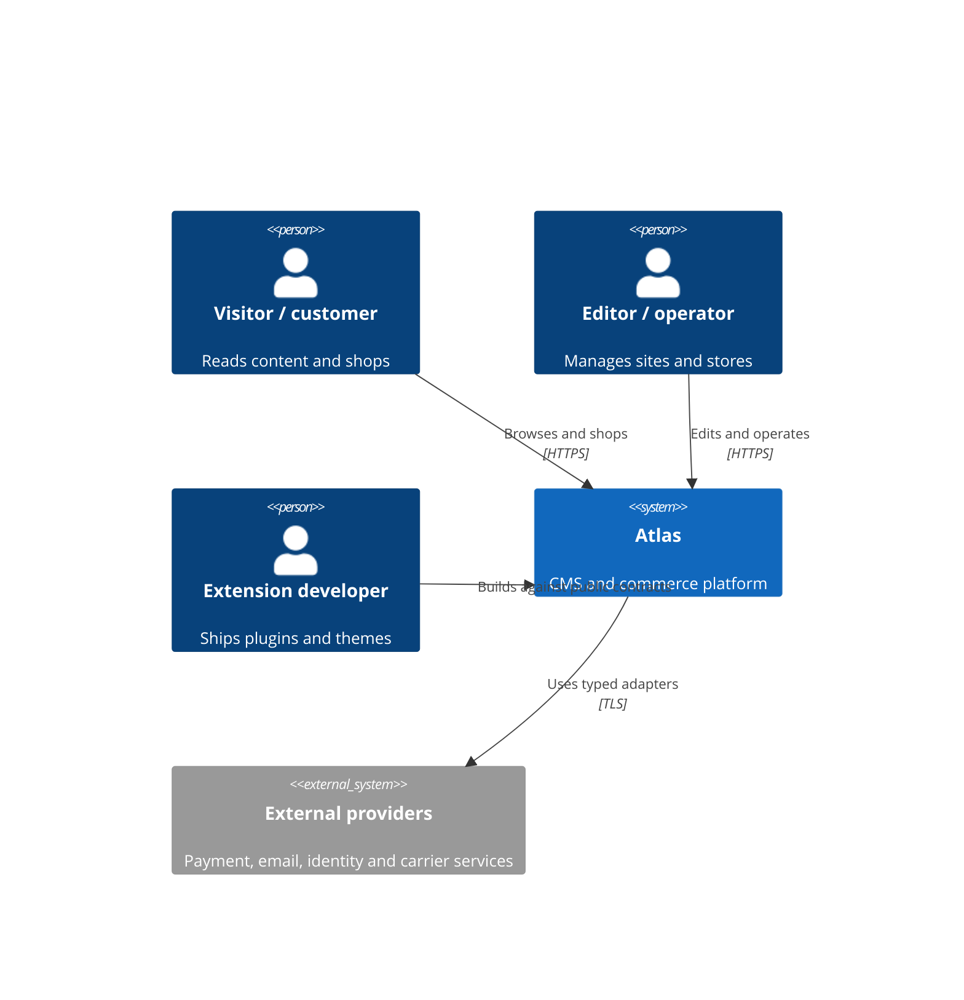
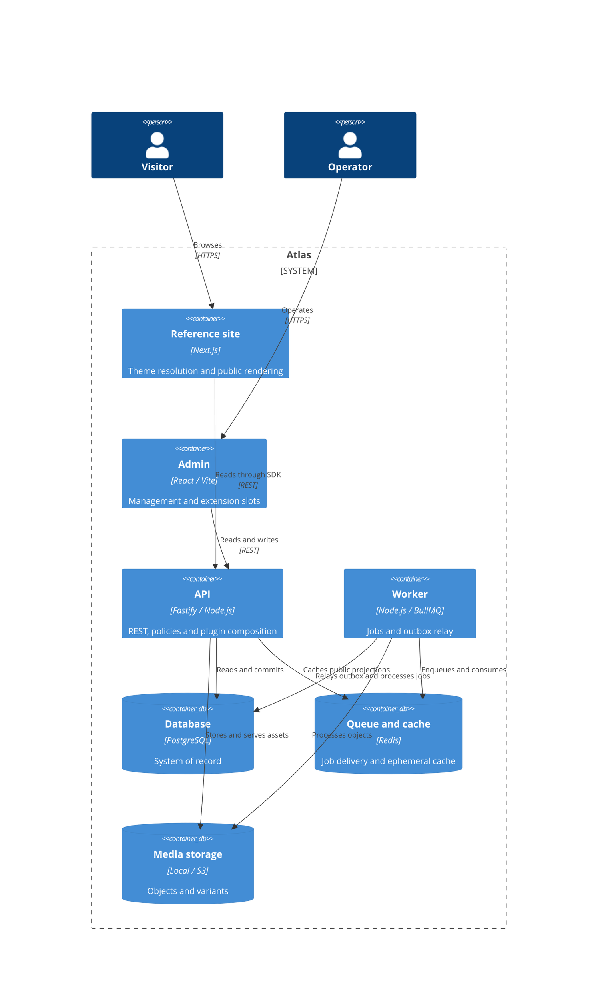
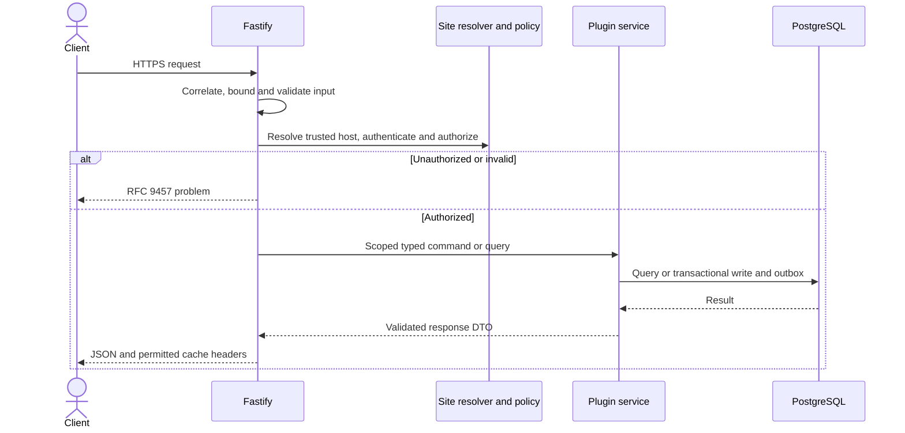
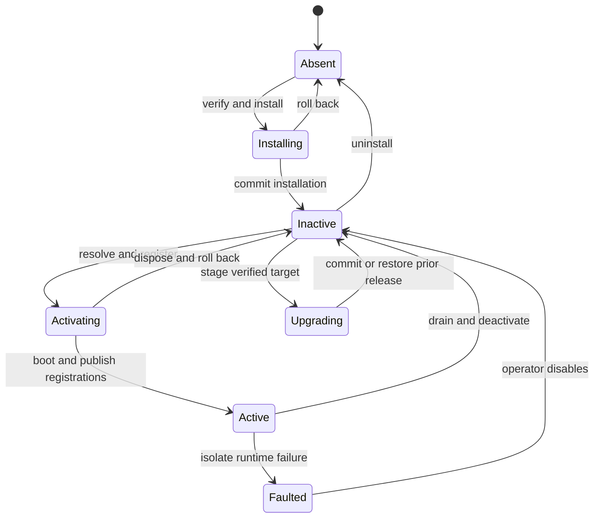
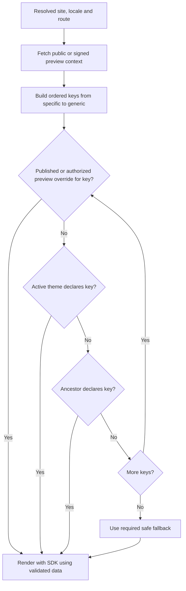

# Atlas architecture

Phase 0 defines the target architecture. The current workspace contains buildable boundaries and verification tooling. Delivery milestones are in the [roadmap](../roadmap.md).

## Boundaries and dependencies

| Layer                                           | Allowed dependencies                                                                                                      |
| ----------------------------------------------- | ------------------------------------------------------------------------------------------------------------------------- |
| API composition root                            | Kernel, core infrastructure packages, and the public entry points of configured plugins                                   |
| Kernel                                          | Configuration, database, authentication, hooks, and public extension contracts                                            |
| Database, hooks, config, i18n, public contracts | External libraries and explicitly declared lower-level contracts. Database and hooks are independent of application code. |
| Authentication                                  | Config, database, and public policy contracts                                                                             |
| Plugin SDK                                      | Public contracts and interfaces injected by the host. It has no kernel dependency.                                        |
| Testkit and migration adapters                  | Public SDK and contracts. Only the testkit may depend on infrastructure test fixtures.                                    |
| First-party and third-party plugins             | Public SDK and declared public contracts of other plugins. Cross-plugin writes go through services or events.             |
| Admin                                           | Public REST contracts, UI and i18n. Extensions receive a documented host API.                                             |
| Site and themes                                 | Frontend SDK, i18n, public contracts, and theme entry points                                                              |
| CLI                                             | Public management APIs and explicit kernel bootstrap or migration APIs for local operator tasks                           |

Every workspace exports a named surface. The lint gate rejects cycles in declared workspace dependencies and checks cross-workspace TypeScript imports against declared dependencies and public entry points. Runtime code and migrations must honor the same rules when loaded dynamically. Apps provide composition. Content, comments, media and commerce do not belong in the kernel. Use adapters for storage (local/S3), mail (SMTP by default), search (PostgreSQL FTS), cache (Redis) and payments (gateway contracts).

## C4 context

## C4 containers

## Request lifecycle and security

Trust forwarded headers only from configured proxies. Resolve host against an indexed domain registry before accessing scoped records. Apply request size and rate limits before expensive work. Authenticate credentials or sessions and check capabilities plus ownership and object state. Use anti-CSRF controls on cookie-authenticated writes, an explicit CORS allowlist, TLS and CSP. Keep keys and tokens out of logs. Sanitize rich content on write and again at rendering boundaries. Treat uploaded bytes and remote URLs as untrusted. Audit privileged writes and denied privileged access with redacted identifiers. OpenTelemetry joins request, transaction, and job traces. Liveness reports process status. Readiness fails while mandatory dependencies or required database versions are unavailable.

## Hooks, events and extensions

Synchronous-in-lifecycle actions and filters may be asynchronous in execution. Await handlers in stable priority and registration order. Filters validate each returned value. Advisory hooks isolate and log failures. Policy or validation hooks fail closed and abort their operation. Registrations have owners and disposer handles. Domain events are immutable past-tense facts emitted to an outbox in the same transaction as the business change. Delivery is at least once and subscribers deduplicate. See [hooks](../contracts/hooks.md) and the [event catalog](../contracts/event-catalog.md).

Extension surfaces include typed routes and schemas, capabilities, domain registrations, admin slots, template slots, jobs, CLI commands, settings and adapter interfaces. Validate manifests, compatibility and permissions before resolving entry points. Core onboards first-party plugins through the same interfaces as third parties.

## Plugin lifecycle

Dependency order is topological and teardown reverses it. Stage registration until activation succeeds. Lock lifecycle changes per scope. Apply transactional migrations with a ledger and namespace validation, and require a recovery plan for operations that cannot roll back atomically. Upgrading an active plugin drains and deactivates it first, then reactivates the committed or restored release. Keep data on uninstall unless explicitly purged under policy. Trusted code may run in process. Untrusted code runs across an OS-enforced boundary with worker RPC inside it. See [ADR 0003](../adr/0003-plugin-isolation.md).

## Theme resolution

Check resource-specific then type-specific keys and finally route-family and default keys. For each key, search published site override (or authorized draft), active theme, then ancestors closest first. A parent's specific template wins over a child's generic template. Reject inheritance cycles and missing required fallbacks at activation. Resolve errors with controlled status and localized views.

## Cache, queue, cron and tenancy

Cache public projections with keys scoped by site, locale, contract version, and query representation. Cache tags link dependent projections to writes. Outbox consumers invalidate Redis and CDN entries after commit. Pair ETags with bounded TTLs to tolerate relay delays. Preview and personalized or private responses bypass shared caches. Separate Redis queue and cache deployments in production to keep eviction from losing jobs.

BullMQ delivers at least once. PostgreSQL records durable schedules, outbox entries and effects that require transactional deduplication. Schedule by UTC instant with an explicit time zone and policy for missed or repeated wall-clock times. Enqueue only once per schedule occurrence using a deterministic key. Retry transient failures with jitter and bounded attempts. Park terminal failures with operator-visible context and controlled redrive. Queue jobs carry site scope and correlation IDs, enforce deadlines, and recheck privileges for delegated operations as applicable.

Tenants contain one or more sites. Users have global identity and explicit scoped membership; operator grants are separate. Domain aliases map to one active site. Use composite scoped keys and foreign keys, plus database row-level security as defense in depth. Set scope per transaction with pool-safe cleanup. Restrict public data to the resolved site. Namespace cache, search, jobs and storage, including signed object access. Test maintenance and administrative flows as well as ordinary requests for isolation. Phase 1 establishes the scope model. Phase 9 delivers full network administration and tenant lifecycle.
